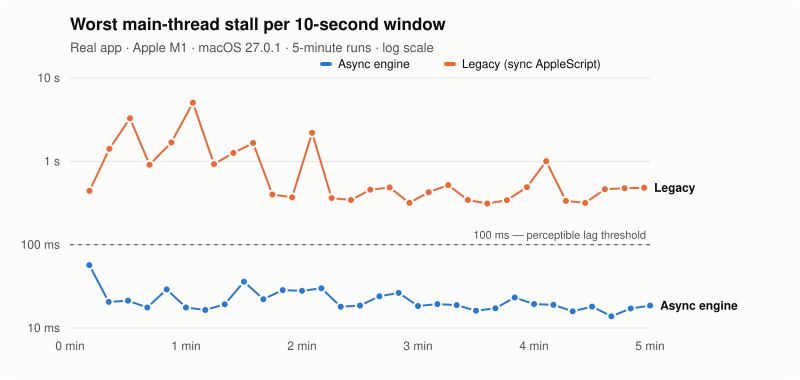
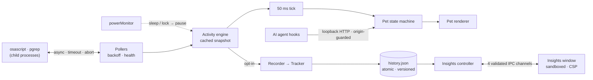

<div align="center">


# Desktop Pets

**A macOS desktop pet that notices what you're doing —<br>without ever freezing your app or leaving your Mac.**

[](https://github.com/Qiao527/desktop-pets/actions/workflows/test.yml)


[](LICENSE)

[Highlights](#highlights) · [Results](#measured-impact) · [How it works](#how-it-works) · [Install](#quick-start) · [Privacy](#privacy--security) · [Docs](#documentation)

</div>

---

Desktop Pets keeps a small pixel character on your desktop. It notices when you
type or play music, dozes off when you step away, reacts to clicks and drags,
and can optionally mirror what your AI coding agents are doing (Claude Code,
Cursor, Codex, Gemini, and others).

This is a macOS-focused fork of [**clawd-on-desk**](https://github.com/rullerzhou-afk/clawd-on-desk)
by [@rullerzhou-afk](https://github.com/rullerzhou-afk) and contributors. The fork's
main contribution is an **Activity Intelligence** subsystem: non-blocking activity
detection, opt-in private time tracking, and an Insights window.
[What's inherited and what's new →](#this-fork-vs-upstream)

## Highlights

<table>
<tr>
<td width="33%" valign="top">

**⚡ AppleScript off the UI thread**<br>
Probes run in child processes with timeouts, cancellation, backoff, and no overlap. The animation loop only reads a cached snapshot.

</td>
<td width="33%" valign="top">

**🔒 Private by default**<br>
Tracking is opt-in, local-only, and stores nothing but minutes per category. Text, titles, and app names are never read.

</td>
<td width="33%" valign="top">

**💾 Crash-safe data**<br>
Atomic `fsync` + rename writes, a last-good backup, corruption quarantine, schema versioning, 90-day retention.

</td>
</tr>
<tr>
<td valign="top">

**🛡️ Hardened surfaces**<br>
A sandboxed Insights window with sender-validated IPC, and a loopback hook server that rejects browser and DNS-rebinding requests.

</td>
<td valign="top">

**🧪 Verified, not assumed**<br>
406 tests, 98% line coverage on the new subsystem (CI-enforced floor), and real-Mac benchmarks and end-to-end runs.

</td>
<td valign="top">

**🎨 Redistributable art**<br>
Pip, the default theme, is generated from code under MIT. Third-party character art is kept out of every build.

</td>
</tr>
</table>

## Measured impact

The original detectors called `osascript` **synchronously on the Electron main
thread** every 400 ms, and each call takes ~220–280 ms on an M1. The new engine
runs the same probes off-thread.

<picture>
  <source media="(prefers-color-scheme: dark)" srcset="docs/media/benchmark-dark.svg">
  
</picture>

| Build | Median p99 delay | Worst single stall | 10-second windows with a stall over 100 ms | Main-process CPU |
|---|---:|---:|---:|---:|
| Legacy (sync) · 3 runs | 249–293 ms | 0.6–5.1 s | **88 / 88** | 1.8–2.5 % |
| Async engine · 2 clean runs | 13.2–13.4 ms | 39–57 ms | **0 / 60** | 3.2 % |

<sub>Real app, Apple M1, macOS 27.0.1, alternating 5-minute runs. A third async run was interrupted by an automatic screen lock: the engine paused as designed, but the lock transition produced stalls up to 7.3 s that are not yet explained. That run is reported separately, not dropped. In later runs under active desktop use (2026-10-27), both Electron 41 and 42 builds still showed occasional 100–360 ms stalls in some windows. These are not from the detectors, and they are under investigation. Full method and raw data: <a href="docs/benchmarks.md">docs/benchmarks.md</a>.</sub>

## See it

<table>
<tr>
<td width="50%"></td>
<td width="50%"></td>
</tr>
<tr>
<td colspan="2" align="center"><sub>Activity Insights, captured from the real sandboxed window and filled with <b>synthetic demo data</b>.</sub></td>
</tr>
</table>

<p align="center"></p>

## How it works



<details>
<summary><b>Key engineering problems and how they were solved</b></summary>

1. **The main thread was blocking on AppleScript.** The fix: async `execFile`, a scheduler built on chained timers with deadline aborts and a generation counter (so `stop()` / `restart()` can never apply a stale result), and a snapshot the 50 ms loop reads without waiting.
2. **Checking whether music was playing opened Music.** `tell application "Music"` launches the app. The fix: run `pgrep` first, send Apple events only to players that are already running, and re-check `is running` inside the script.
3. **Missing permissions looked like "not typing".** AppleScript errors `-1743`, `-1719`, and `-25211` are now classified as `permission-denied`, surfaced in Insights with a button to the right Settings pane, and retried slowly.
4. **Honest time accounting.** Time is split at local hour and day boundaries (DST-aware), gaps from missed sleep events are dropped, backward clock jumps are discarded, and "away" comes from OS input idle time rather than the pet's mouse-only timer.
5. **Durable local data.** Writes go temp file → `fsync` → rename → `fsync(dir)`; corrupt files are quarantined and the store recovers from backup; files written by a newer schema are opened read-only.
6. **Bugs found by verification.** An independent review found enable/disable and delete/flush races, and an end-to-end run found that tracking didn't resume after a restart. Each fix landed with a regression test that fails on the old code.

Design details: [docs/architecture.md](docs/architecture.md)

</details>

## This fork vs upstream

| Area | Upstream (inherited) | This fork |
|---|---|---|
| Activity detection | — | Async macOS detectors: timeouts, cancellation, backoff, permission handling, sleep/lock pausing |
| Typing / music reactions | — | Added early in the fork with synchronous AppleScript, then **rewritten** because it blocked the main thread and opened Music |
| Time tracking & Insights | — | Opt-in tracker, versioned store, sandboxed Insights window |
| Default artwork | Clawd (Anthropic character), Calico (all rights reserved) | **Pip**, original and MIT; third-party art excluded from builds |
| Agent hooks | Written into six tools' configs on every launch | Only after the user opts in |
| Hook server | Loopback, unauthenticated | + browser-origin and DNS-rebinding guard |
| Tests / CI | 308 tests, release-only workflow | 406 tests, coverage floor, macOS packaging check, dependency and secret scanning |
| Pet engine, windows, state machine, agent integrations, theme system | ✅ upstream | unchanged except where listed |

The full list of inherited components is in [NOTICE.md](NOTICE.md).

## Quick start

Requires macOS, Node.js 22 or 24 ([`.nvmrc`](.nvmrc)), and Git.

```bash
git clone https://github.com/Qiao527/desktop-pets.git
cd desktop-pets
npm ci
npm start
```

Pip appears near the bottom of the screen, with an icon in the menu bar. Right-click the pet for the menu.

<details>
<summary><b>Optional permissions, tracking, and agent integration</b></summary>

- **Accessibility** lets the pet notice a focused text field. **Automation → Music / Spotify** lets it notice music playing. When running from source, grant both to your terminal app in System Settings → Privacy & Security. Without them the pet still works, and Insights shows which detector needs access.
- **Activity tracking** is off until you turn it on: right-click → *Activity Insights…* → *Tracking*.
- **AI agent integration** is off until you turn it on: right-click → *Connect AI Coding Agents*. Only then are hooks added to the agents' own config files.

</details>

<details>
<summary><b>Build, test, and benchmark</b></summary>

```bash
npm test                     # 406 unit + integration tests (node:test)
npm run test:coverage        # coverage for the activity subsystem, with enforced minimums
npm run build:mac:unsigned   # DMG for arm64 + x64 (never uses a keychain signing identity)
npm run check:package        # after an arm64 build: verify only redistributable files are bundled

# reproduce the benchmark (see docs/verification.md)
perf/activity-detectors/run-app.sh "$PWD" async-r1 300 /tmp/bench
node perf/activity-detectors/summarize.js /tmp/bench/*.jsonl --md
```

CI ([test.yml](.github/workflows/test.yml)) runs on every push and PR: tests on macOS and Ubuntu, a coverage gate, an unsigned macOS app build with a package-content check, `npm audit` on production dependencies, and gitleaks. CI does **not** exercise real macOS permissions or the GUI; those checks are recorded in [docs/verification.md](docs/verification.md).

</details>

## Privacy & security

- **Opt-in and local.** Nothing is recorded, or even created on disk, until you enable tracking. Data never leaves the Mac, and there is no telemetry.
- **Minimal data.** Only milliseconds per category per hour are stored. The text detector reads the focused element's *role*, never its value.
- **Your controls.** Pause tracking at any time, or delete the history, its backup, and any quarantined copies in one step.
- **Hardened.** The Insights window is sandboxed with a strict CSP and validated IPC. The local hook server rejects browser and DNS-rebinding requests.

Details: [docs/privacy.md](docs/privacy.md) · [SECURITY.md](SECURITY.md)

## Documentation

| Doc | What's inside |
|---|---|
| [Architecture](docs/architecture.md) | Processes, data flow, poller guarantees, accounting rules, storage, IPC security |
| [Benchmarks](docs/benchmarks.md) | Method, raw data, results, and limitations |
| [Verification](docs/verification.md) | Real-Mac checks performed and still to do, with steps |
| [Privacy](docs/privacy.md) · [Security](SECURITY.md) | What is read and stored; threat model; known issues |
| [Changelog](CHANGELOG.md) · [Contributing](CONTRIBUTING.md) | Release notes; how to propose changes |

## Known limitations

- "Typing" means *a text field has focus while you are active*. Keystrokes are never observed.
- Media detection covers Apple Music and Spotify only.
- From source, macOS grants detector permissions to your terminal, not to the app.
- Builds are unsigned and not notarized.
- The inherited pet windows are not fully sandboxed; only the new Insights window is.
- Occasional 100–360 ms main-thread stalls remain during active desktop use. They are not caused by the detectors and are under investigation ([benchmarks](docs/benchmarks.md#follow-up-electron-41-vs-42-2026-10-27)).
- Windows and Linux code paths are inherited and untested in this fork.

## Credits & license

- **Code:** [MIT](LICENSE). Upstream copyright is retained, and the [upstream authors](https://github.com/rullerzhou-afk/clawd-on-desk/graphs/contributors) built the pet engine this fork extends.
- **Artwork:**
  - Pip's artwork, icons, and sounds are original, MIT, and generated by [`tools/pip-theme/build.js`](tools/pip-theme/build.js).
  - Clawd and Calico artwork in the source tree belong to their owners ([assets/LICENSE](assets/LICENSE)) and are not included in builds.
  - Pochacco is a Sanrio character and is not part of this repository.
- **AI assistance:** parts of this fork were developed with Claude Code. The commits in the initial pull requests (#1–#5) record this with a `Co-Authored-By` trailer.
