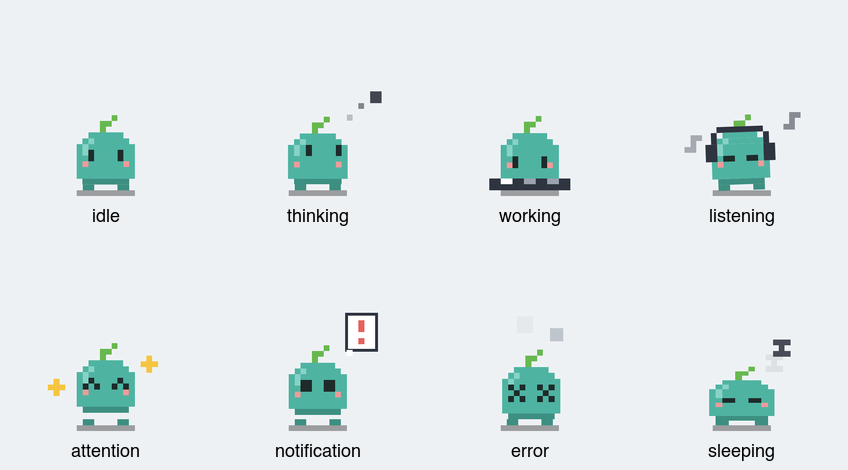
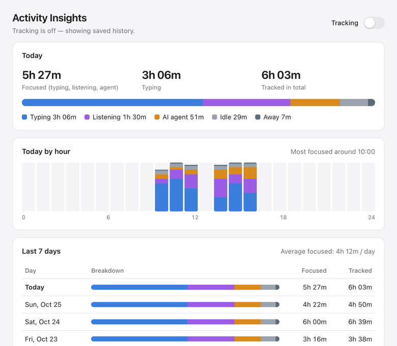
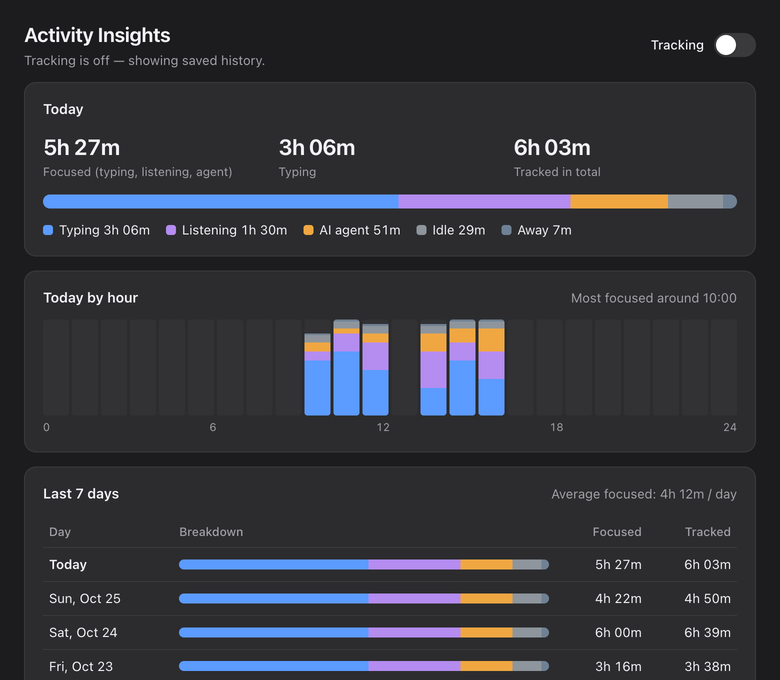

<h1 align="center">Desktop Pets</h1>
<p align="center">A macOS desktop pet that reacts to what you are doing — without ever freezing your app or leaving your Mac.</p>

<p align="center">
  
</p>

Desktop Pets is an Electron app that keeps a small animated character on your
desktop. The pet notices when you are typing or listening to music, gets sleepy
when you step away, reacts to clicks and drags, and can optionally mirror the
state of AI coding agents (Claude Code, Cursor, Codex, Gemini, and others).

This repository is a fork of
[**clawd-on-desk**](https://github.com/rullerzhou-afk/clawd-on-desk) by
[@rullerzhou-afk](https://github.com/rullerzhou-afk) and contributors. The fork
focuses on macOS and adds an **Activity Intelligence** subsystem: non-blocking
activity detection, opt-in private time tracking, and an Insights window.

> **Platform:** macOS (tested on macOS 27.0.1, Apple M1). Inherited Windows and
> Linux code paths are kept but are not built, tested, or supported by this fork.

## Contents

- [What this fork adds](#what-this-fork-adds)
- [Measured results](#measured-results)
- [Architecture](#architecture)
- [Install and run](#install-and-run)
- [Testing](#testing)
- [Privacy and security](#privacy-and-security)
- [Known limitations](#known-limitations)
- [Attribution and licensing](#attribution-and-licensing)

## What this fork adds

| Area | Upstream (inherited) | This fork |
|---|---|---|
| Activity detection | — | Asynchronous macOS detectors with timeouts, cancellation, non-overlapping scheduling, backoff, permission handling, sleep/lock pausing ([`src/activity/`](src/activity)) |
| Typing / music reactions | — | Added in the fork's first commits with synchronous AppleScript; **rewritten** here because it blocked the main thread and launched Music |
| Time tracking | — | Opt-in tracker with midnight/DST-correct accounting and a versioned, atomic, corruption-tolerant local store |
| Insights window | — | Sandboxed Electron window with today/hourly/7-day summaries, detector health, permission help, and delete controls |
| Default artwork | Clawd (Anthropic character) and Calico (all rights reserved) | **Pip**, an original theme generated from code (MIT); third-party art excluded from builds |
| Agent hooks | Written into six tools' configs on every launch | Only after the user opts in |
| Tests / CI | 308 unit tests, release-only workflow | +98 tests (406 total: detectors, scheduling, accounting, storage, IPC security, theme), test workflow on push/PR |
| Pet engine, windows, state machine, agent integrations, themes system | ✅ upstream | unchanged except where listed |

A full list of inherited components is in [NOTICE.md](NOTICE.md).

### Key engineering problems

1. **The main thread was blocking on AppleScript.** Every 400 ms the 50 ms
   animation loop called `execFileSync("osascript")`. One probe takes about
   220 ms on an M1, so for most of each second the main thread could not
   animate, handle IPC, or serve agent hooks. → Async `execFile`, a poller with
   chained timers, and a cached snapshot the animation loop reads without
   waiting. ([architecture](docs/architecture.md#why-the-detectors-are-polled-out-of-band))
2. **Checking whether music is playing opened Music.** `tell application
   "Music"` launches the app. → `pgrep` first, Apple events only to running
   players, plus an in-script `is running` re-check.
3. **Missing permissions looked like "not typing".** → AppleScript error codes
   are classified (`-1743`, `-1719`, `-25211`), surfaced in Insights, and
   retried slowly.
4. **Honest time accounting.** Midnight and DST boundaries, missed sleep
   events, backward clock jumps, and quitting mid-segment are handled
   explicitly and covered by tests.
5. **Durable local data.** Atomic writes with `fsync`, a last-good backup,
   quarantine of corrupt files, schema versioning, and read-only handling of
   files from newer versions.

## Measured results

Real app, Apple M1, macOS 27.0.1, same prefs and theme, Music and Spotify
running, alternating 5-minute runs. Event-loop delay is
sampled by `perf_hooks.monitorEventLoopDelay` (10 ms resolution, so ~11 ms
means "no delay").

| Build | Runs | Median per-window p99 delay | Worst single stall | 10 s windows with a stall > 100 ms | Main-process CPU |
|---|---|---|---|---|---|
| Legacy (sync `osascript`) | 3 × 5 min | 249–293 ms | 0.6–5.1 s | **88 / 88** | 1.8–2.5 % |
| Async engine | 2 × 5 min (clean) | 13.2–13.4 ms | 39–57 ms | **0 / 60** | 3.2 % |

A third async run was interrupted by an automatic screen lock. The engine
paused as designed, but the lock transition itself produced stalls of up to
7.3 s that are not yet explained. It is reported separately rather than hidden.
The async build costs about 0.5–1 point more main-process CPU.

Methodology, raw data, and caveats: [docs/benchmarks.md](docs/benchmarks.md).

## Architecture

```
osascript / pgrep ──async──▶ poller (per detector) ──▶ engine snapshot ──▶ 50 ms tick ──▶ state machine ──▶ renderer
                                   │ health                  │ (opt-in)
                                   ▼                         ▼
                              Insights window ◀── recorder → tracker → atomic JSON store
                              (sandboxed, 4 validated IPC channels)
```

Details: [docs/architecture.md](docs/architecture.md).

## Install and run

Requirements: macOS, Node.js 22 or 24 (LTS), Git.

```bash
git clone https://github.com/Qiao527/desktop-pets.git
cd desktop-pets
npm ci
npm start
```

Pip appears near the bottom of your screen and a small icon appears in the
menu bar. Right-click the pet for the menu.

**Optional permissions** (System Settings → Privacy & Security). When running
from source, grant them to your terminal app:

- *Accessibility* — lets the pet notice when a text field is focused.
- *Automation → Music / Spotify* — lets it notice music playing.

If either is missing, the pet keeps working, and Activity Insights shows which
detector needs permission, with a button to open the right settings pane.

**Activity tracking** is off until you enable it: right-click → *Activity
Insights…* → *Tracking*.

<p align="center">
  
  
</p>
<p align="center"><sub>Screenshots captured from the real Insights window, filled with <b>synthetic demo data</b>.</sub></p>

**AI agent integration** is off until you enable it: right-click → *Connect AI
Coding Agents*. Only then are hooks added to the agents' own config files.

### Build a macOS app

```bash
npm run build:mac:unsigned   # DMG for arm64 and x64 in dist/ (ad-hoc signed)
npm run check:package        # after an arm64 build: verify bundled files
```

`build:mac:unsigned` disables code-signing identity discovery, so the build
never picks up a personal Apple ID certificate from your keychain. The app is
not notarized; Gatekeeper asks you to confirm the first launch. CI builds the
arm64 app bundle and runs the package check on every push.

## Testing

```bash
npm test                                  # 406 unit/integration tests, Node built-in runner
node perf/activity-detectors/summarize.js perf/activity-detectors/results/*/*.jsonl --md
```

CI runs `npm ci && npm test` on macOS and Ubuntu for every push and pull
request ([.github/workflows/test.yml](.github/workflows/test.yml)). CI does
**not** exercise real macOS permissions or the GUI; those were verified
manually on hardware — see [docs/verification.md](docs/verification.md).

| Suite | Covers |
|---|---|
| `activity-poller` | scheduling cadence, non-overlap, timeouts, backoff/jitter, permission retry, stop/restart races, refresh coalescing, latency stats |
| `activity-exec` | error classification, real child-process timeout/cancellation, event loop stays responsive |
| `activity-detectors` | role parsing, permission surfacing, never messaging non-running players, no sync `child_process` anywhere in `src/` |
| `activity-engine` | snapshot publishing, suspend+lock pause/resume, listener cleanup, adaptive intervals, typing/listening regression table |
| `activity-tracker-store` | midnight split, gap dropping, clock skew, atomic save, corruption recovery, newer-schema read-only, retention, delete |
| `activity-recorder` | opt-in (no files before enable), sleep/lock exclusion, disable flush, delete |
| `insights-security` | sandbox flags, navigation/popup/permission denial, sender validation, argument validation, settings allowlist, CSP |
| `default-theme` | theme validity, fallback, packaging excludes third-party art |

## Privacy and security

- Tracking is opt-in and local-only; only per-category durations are stored.
- The text detector reads the focused element's **role**, never its value.
- No network access for activity data; no telemetry.
- Insights runs sandboxed with a strict CSP and validated IPC.

Full details: [docs/privacy.md](docs/privacy.md).

## Known limitations

- "Typing" means *a text field has focus*, not that keys are being pressed.
- Media detection supports Apple Music and Spotify only.
- Detector permissions are granted per launching app; from source this is your terminal.
- The packaged build is unsigned; signing/notarization needs an Apple Developer account.
- Inherited pet windows (render, hit-test, bubbles) do not use `sandbox: true`; only the new Insights window does.
- Windows/Linux paths are inherited and untested in this fork.

## Attribution and licensing

- Source code: [MIT](LICENSE). Upstream copyright is retained.
- Pip artwork, icons and sounds: original to this fork, MIT, generated by
  [`tools/pip-theme/build.js`](tools/pip-theme/build.js).
- Clawd and Calico artwork in the source tree belong to their owners
  ([assets/LICENSE](assets/LICENSE)) and are **not** included in builds.
- Pochacco is a Sanrio character and is not part of this repository.
- Parts of this fork were developed with AI assistance (Claude Code); commits
  record this with a `Co-Authored-By` trailer.

See [NOTICE.md](NOTICE.md).
